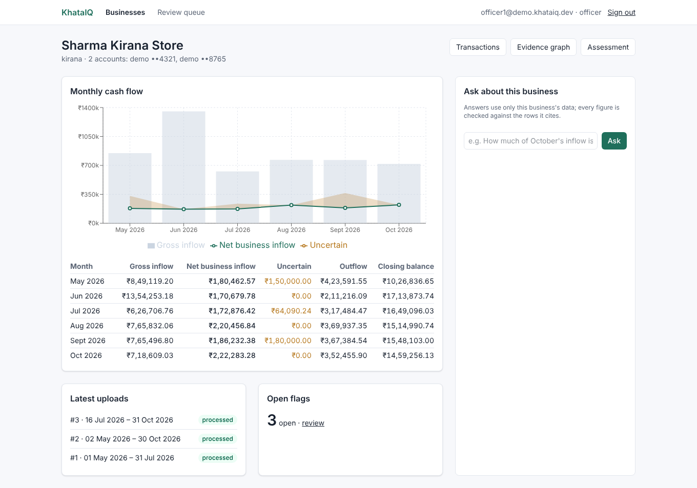
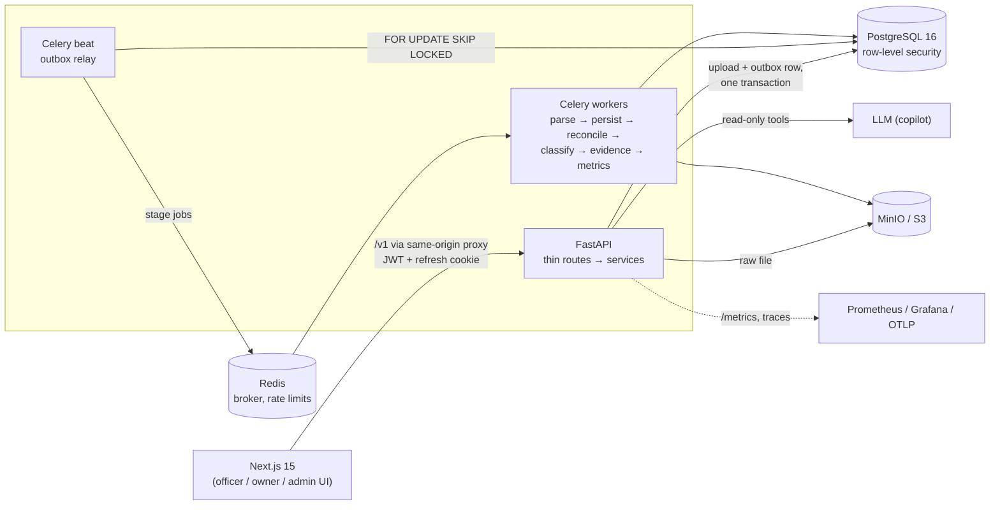
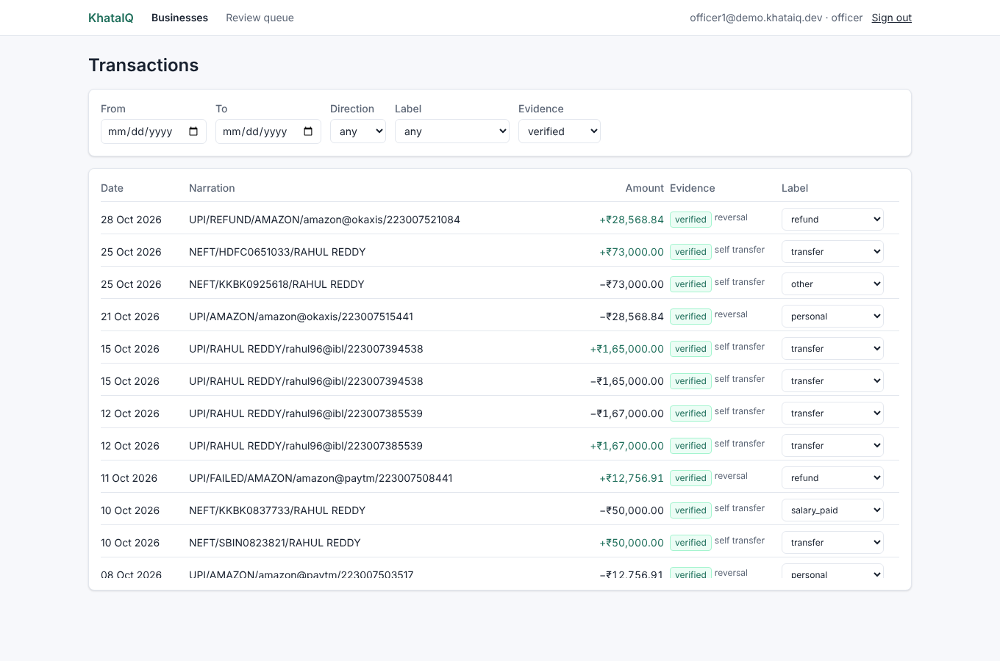
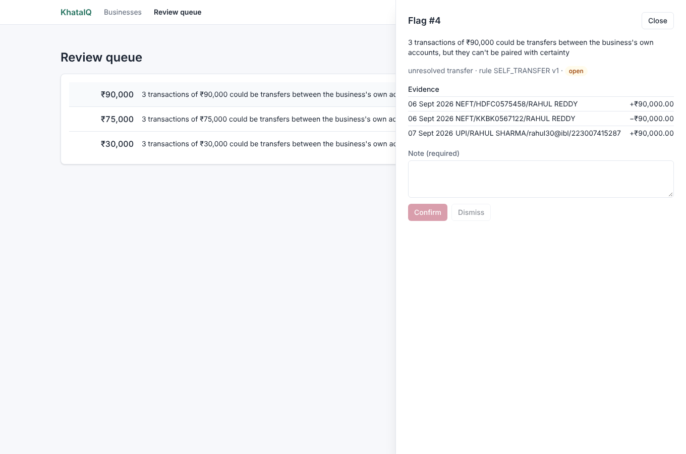
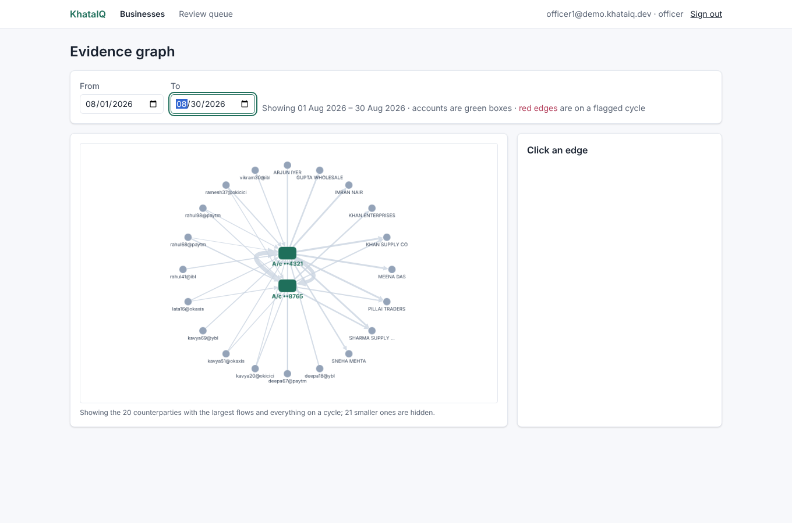

# KhataIQ

**Cash-flow evidence for small-business lending.** A loan officer in India gets a small shop's bank and
UPI statements and has to decide how much real business income runs through them. KhataIQ parses the
statements, refuses any statement whose running balance doesn't reconcile, and separates real income from
money that only looks like income: transfers between the owner's own accounts, reversals, duplicated rows,
round trips through a third party and loan disbursals. Each finding is deterministic, versioned and
linked to the exact rows that prove it. The officer gets monthly cash flow with an explicit "uncertain"
band, a review queue for what the rules could not decide, and a copilot whose every ₹ figure is
checked against the rows it cites. **Every number traces back to source rows.**



## Run it

With Docker, one command (the first build takes a few minutes):

```bash
scripts/demo.sh
```

Open <http://localhost:3000> and sign in as `officer1@demo.khataiq.dev` (or `owner1@…`, `admin1@…`) with
password `khataiq-dev-password`. The demo org has two businesses; *Sharma Kirana Store* comes with six
months of synthetic statements already processed. `scripts/demo.sh down -v` stops it and deletes the
data. Export `LLM_API_KEY` first to enable the copilot. A 3-minute walkthrough is in
[`docs/demo.md`](docs/demo.md).

<details>
<summary>Development setup (without the Docker app images)</summary>

```bash
docker compose up -d                 # Postgres 16, Redis 7, MinIO
pip install -e '.[dev]'
alembic upgrade head && python scripts/seed_dev.py
uvicorn khataiq.api.main:app --reload
celery -A khataiq.pipeline.celery_app worker -Q pipeline -l info   # and `... beat` for the outbox relay
cd frontend && npm ci && npm run dev
```

Checks: `ruff check . && python -m mypy khataiq synthetic && python -m pytest -q` (409 tests; the
integration tests run when `KHATAIQ_TEST_DATABASE_URL` is set, and are skipped otherwise), and
`scripts/e2e.sh` for the Playwright test across the whole stack.
</details>

## Architecture



- **An upload is a row plus an outbox row, written in one transaction.** A relay moves outbox rows to
  Celery, so a crash can't lose or double-queue a job. Each stage is idempotent and records its attempt,
  so redelivery is harmless.
- **Reconciliation is a hard gate.** If the opening balance plus the rows doesn't produce every printed
  running balance, the upload stops there, and the officer sees the exact line and the expected and
  actual balances.
- **Tenant isolation is enforced twice.** Every query is scoped by `org_id` in the services, and Postgres
  row-level security on every tenant table rejects anything that slips through. The app's database role
  can't bypass it, and it can't update or delete `audit_log`.
- Details: [`docs/architecture.md`](docs/architecture.md), specs in [`docs/specs/`](docs/specs/), and the
  build plan in [`docs/BUILD_PLAN.md`](docs/BUILD_PLAN.md).

| Transactions with labels and evidence | Review queue | Money-flow graph |
| --- | --- | --- |
|  |  |  |

## Results

All measured on **synthetic** data with planted ground truth. There are no labelled real statements,
so these numbers show that the pipeline finds what was planted, not that it is accurate on real banks.
Each page says what it does and doesn't show.

| What | Result | Details |
| --- | --- | --- |
| Evidence rules, 200 businesses, 115,596 transactions | precision 1.000 for all five rules; recall 1.000 for four, 0.974 for CYCLE (the misses are explained) | [`evidence_eval.md`](docs/results/evidence_eval.md) |
| Transaction labels (rules + TF-IDF/logistic regression), held-out businesses | macro-F1 0.534 rules only → **0.831** | [`label_model.md`](docs/results/label_model.md) |
| 1–3 month cash-flow forecast (LightGBM vs seasonal naive) | MAE 18–22% lower at 1–2 months, 0.2% at 3; **not shown in the app** | [`forecast.md`](docs/results/forecast.md) |
| Load: 50 users, one 4-vCPU VM | 50.8 req/s, 0 errors, p95 130 ms overall (graph 290 ms); upload → processed p95 2.6 s | [`load.md`](docs/results/load.md) |
| Credit-risk benchmark (Home Credit) | code complete; **not run** (data needs a Kaggle account) | [`risk_benchmark.md`](docs/results/risk_benchmark.md) |

## Design decisions

1. **Money is `int` paise end to end**: Python, `BIGINT` columns, and JSON fields ending in `_paise`.
   Rupees are formatted only in the UI. A float never touches money, so sums are exact and
   reconciliation can demand equality, not "close enough".
2. **Deterministic rules decide evidence; ML only assists.** Self-transfer, reversal, duplicate, cycle
   and loan rules each carry a `rule_id` and `rule_version` and produce `verified`, `inferred` or
   `unresolved`. The label model stores a confidence but never sets an evidence level, and ambiguity goes
   to a human instead of being guessed. Ambiguous money is reported as an *uncertain* band, not silently
   counted as income or dropped from it.
3. **Re-uploading never adds rows.** Each row gets a fingerprint (account, date, amount, direction,
   normalised narration, running balance). The balance keeps two genuine identical ₹500 payments on
   the same day apart. Overlapping statements and retried uploads merge into one ledger.
   Per-upload `upload_rows` keep each statement's own sequence for its reconciliation check.
4. **Evidence results are versioned runs.** A newer upload can change what an earlier finding means. Each
   evidence run supersedes stale flags and reopens them if the finding comes back, and metrics record
   which run they were computed from.
5. **The copilot is checked, not trusted.** It reads only through typed, read-only, tenant-scoped tools.
   The server rejects answers that cite rows those tools didn't return, or that state a ₹ figure that
   isn't a cited value (or a small sum of distinct cited values). The model gets one retry, then the
   copilot declines.
6. **Boring infrastructure on purpose.** Postgres is the system of record, with the outbox pattern
   instead of a second queue's guarantees, and the API is thin with logic in `services/`. Logs are JSON,
   with account numbers masked and narrations never logged.

## Limitations

- **Formats.** It reads demo-bank CSV, configurable generic CSVs (HDFC- and SBI-like layouts) and
  text-based PDFs. There's no OCR for scanned PDFs and no Account Aggregator integration.
- **Synthetic evaluation only.** The generator and the rules come from the same spec, so real statements
  will have narration formats and edge cases this data never exercises.
- **CYCLE windows.** Round trips that take 16–30 days can straddle two detection windows and be missed.
- **No credit decisions.** KhataIQ measures cash flow and evidence; assessments are human decisions. The
  forecast and the risk benchmark stay in `experiments/` until they can be validated on real outcomes.
- **Copilot** behaviour is tested against a scripted fake LLM; it hasn't been exercised against the live
  API in CI.
- **Single-host deployment** (`docker-compose.prod.yml`; see [`docs/deploy.md`](docs/deploy.md)).
  There's no HA Postgres, and secrets come from an env file rather than a secrets manager.

## Repository map

```
khataiq/            core/ (pure ledger logic) · pipeline/ · evidence/ · classify/ · metrics/ · copilot/
                    api/ (routes, schemas) · services/ · models/ · storage, audit, security, observability
alembic/versions/   migrations 0001–0009 (RLS policies, roles, views)
frontend/           Next.js app, Playwright tests
synthetic/          statement generator with ground truth, evaluation, label-model training
experiments/        forecast and risk benchmark (never imported by the app)
ops/                Grafana dashboard, Prometheus config, Locust load test, demo env
docs/               architecture, plan, specs, results, learning notes per milestone
```
